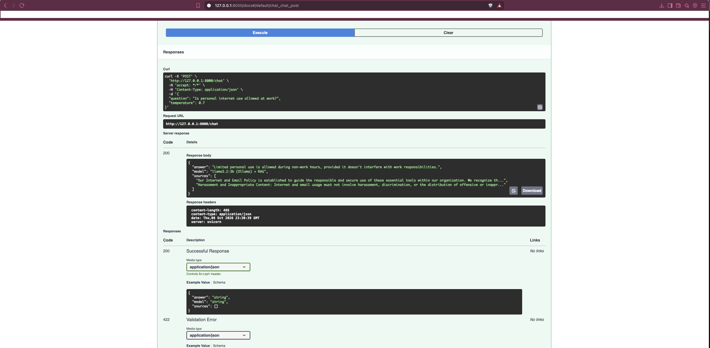

# policy-rag-eval

A local RAG chatbot over a company policy file, with a small evaluation set and a human review report.

It answers from retrieved chunks. If the documents do not cover the question, the API says “I don’t know” and returns no sources.

## What it shows
- Ingest a policy text file into Chroma
- Answer from retrieved chunks with a local model
- Hide sources on “I don’t know”
- Score answers by hand, with DeepEval as a second pass

Human review is the result. DeepEval on `llama3.2:3b` is not the quality gate.

## Demo



## Stack
- FastAPI
- Chroma and `all-MiniLM-L6-v2` embeddings
- Ollama `llama3.2:3b`
- DeepEval: faithfulness and answer relevancy

## Documents

The repo does not include the policy file. Add your own text file before ingesting:

```bash
mkdir -p documents
# Put a .txt or .pdf here, for example:
# documents/company_policies.txt
```
Then edit ingest.py if the filename is different, and run. 

## Run
```bash
python -m venv venv
source venv/bin/activate
pip install -r requirements.txt
ollama pull llama3.2:3b
python ingest.py
uvicorn main:app --reload 
```
Open http://127.0.0.1:8000/docs.

- `POST /ingest` uploads a `.txt` or `.pdf`
- `POST /chat` asks a question
- `GET /health` checks the server

Ollama must be running.

## Evaluate
```bash
python eval_rag.py
```
Scores and notes are in `eval_report.md`.

## Findings
- In-policy questions can be grounded.
- “I don’t know” no longer returns irrelevant sources from the API.
- `llama3.2:3b` still reverses who pays whom on the phone reimbursement rule.
- Some adversarial prompts still leak the instructions.

## Not in this repo
- Cloud deployment
- A second-model comparison